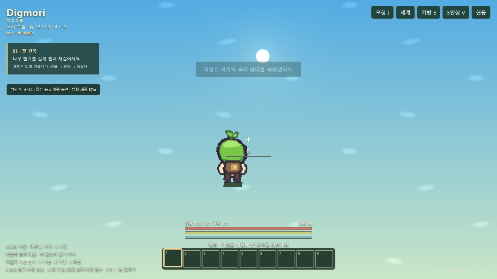

# 디그모리 · Digmori

작은 생명으로 넓은 2.5D 세계를 탐험하는 채굴·건설 샌드박스 게임입니다. 빈 가방으로 시작해 자원을 모으고 도구를 만들며, 동굴·6방 던전·봉인 보물함·수호체를 발견합니다. XP·레벨·스탯과 모험창으로 탐험 진척을 확인할 수 있습니다.

**[게임 실행](https://byh-playground.github.io/bloom-digmori/)** · 버전 **0.25.0**



## 조작

| 동작 | PC | 모바일 |
| --- | --- | --- |
| 이동·달리기 | WASD, Ctrl+앞 이동 | 왼쪽 조이스틱, 앞으로 바깥까지 밀면 달리기 |
| 시야·시점 | 화면 클릭 후 마우스, V | 화면 드래그, 시점 버튼; 두 손가락 벌리기/모으기로 거리 조절 |
| 공격·채굴 | 좌클릭, 길게 누르기; 무기는 누른 뒤 놓으면 차지 공격 | 공격 버튼 또는 대상 탭; 블록은 길게 누르기 |
| 기술·설치 | 우클릭 | 보조 행동 버튼 또는 블록을 든 상태에서 화면 탭 |
| 사용·메뉴 | F 사용, E 가방, J 모험 | 해당 대상 탭, 상단 가방·모험 버튼 |
| 점프·회피·수영 | Space 점프/상승, Shift 회피/잠수 | 점프·회피 버튼 |
| 아이템 선택·버리기 | 1–9 또는 휠, Q 1개/Ctrl+Q 묶음 버리기 | 하단 슬롯 탭 |

모바일은 가로 화면을 권장합니다. 상단 **세계**에서 새 월드, 저장·불러오기, 파일 내보내기·가져오기를 사용할 수 있습니다. 가방이나 모험창을 열어도 월드 시간은 진행됩니다.

## 로컬 실행·개발

Node.js 22 이상. 빌드는 외부 패키지 설치 없이 실행할 수 있고, 실제 게임은 고정 SDK를 CDN에서 로드하므로 인터넷 연결이 필요합니다.

```sh
git clone https://github.com/byh-playground/bloom-digmori.git
cd bloom-digmori
npm run build
npm run dev
```

브라우저에서 http://127.0.0.1:8000/bloom-digmori/ 를 엽니다. 배포 산출물은 **dist/index.html 하나**이며 게임 CSS·로직을 포함합니다. 외부 SDK까지 내장한 오프라인 HTML은 아닙니다. `file://` 직접 실행은 이번 검증 범위가 아닙니다.

```sh
npm ci
# Windows: 설치된 Microsoft Edge 사용
npm test
# Linux: Chromium 설치 후 실행
npx playwright install --with-deps chromium
npm test
```

`BROWSER_CHANNEL`로 실행 브라우저를 지정하고 `TEST_URL`로 공개 사이트에 같은 E2E를 실행할 수 있습니다. `TEST_REPORT`는 JSON 기록 목적지입니다. 전체 검증 상한은 180초입니다.

## 소스·빌드 구성

```text
src/
  core/           버전·설정·공통 수학
  data/           블록·아이템·제작·진척 정의
  progression/    RPG
  inventory/      슬롯·제작 상태
  world/          지형·물·청크 메시
  simulation/     물리·전투·시뮬레이션
  presentation/   애니메이션·아트·렌더
  input/          PC·터치 입력
  runtime/        세션·앱·저장·SDK 부팅
  ui/             HTML 틀·CSS·HUD
  order.json      단일 모듈 조립 순서
scripts/          빌드·로컬 정적 서버
tests/            고정 사용자 흐름 E2E
dist/             자동 생성; Git에 넣지 않음
```

**소스 SSOT는 src/**입니다. 원본 HTML의 기능 경계를 따라 나눈 소스 조각을 `order.json` 순서로 하나의 ESM 스코프에 합칩니다. 파일 사이에 별도 런타임 래퍼나 호환 계층을 추가하지 않았습니다. 생성 HTML을 직접 수정하지 않습니다. 원본의 심볼·저장 키는 불필요하게 바꾸지 않습니다.

빌드는 조립된 모듈의 구문 검사 후 HTML과 `build.json`을 만듭니다. CI는 PR에서 빌드하고, main 변경 시 같은 정적 artifact를 GitHub Actions Pages로 배포합니다. [배포 정보](https://byh-playground.github.io/bloom-digmori/build.json)는 Git SHA·HTML SHA-256·버전·GameKit SHA·UTC 빌드 시각을 기록합니다.

## 기술 구성

| 구성 | 고정 기준 |
| --- | --- |
| Rapier deterministic compat | `@dimforge/rapier3d-deterministic-compat@0.21.0`, 실제 WASM 물리 |
| Bloom GameKit | dist `87cac89042256297c025e880aa70ad9cd25ef8ab` |
| GameKit 단독 플레이 모듈 | debug-tools, input, simloop, presentation-events, audio |
| 협동 | GameKit transport·rollback, Nostr/WebRTC; 접속 시 로드 |
| 그래픽·저장 | WebGL, 청크 Worker, IndexedDB 및 월드 파일 |

SDK 경로·버전·모듈 해시의 원본은 [core/config.js](src/core/config.js)입니다. `main`/`latest` 같은 가변 SDK 참조는 사용하지 않습니다.

## 버전·저장 호환

게임과 snapshotVersion은 **0.25.0**입니다. 이전 0.21 및 0.24.x 저장과 비호환이므로 **새 월드가 필요합니다**. 자동 변환 어댑터나 이전 저장 삭제 기능은 추가하지 않았습니다. 기존 IndexedDB·설정 키 및 `.bloom` 파일 포맷을 유지하며 내보내기 파일 표시 이름만 Digmori로 바꿨습니다.

브라우저 저장은 출처에 종속됩니다. 기존 로컬/다른 사이트 저장이 새 Pages 주소로 자동 이동하지 않습니다. 0.25.0 월드는 게임의 내보내기·가져오기를 사용할 수 있습니다.

## 검증

[실제 실행 기록](docs/verification-initial.json): Windows Edge 155, 고정 실제 SDK, 정적 `/bloom-digmori/` 경로에서 새 게임 → WASD 이동 → 풀흙 채굴 → 흙 회수·설치 → 저장 → 새로고침 → 복원을 검증합니다. 게임 상태를 주입하거나 SDK를 mock하지 않고 UI 입력과 읽기 전용 상태 관측을 사용합니다. 5개 GameKit 모듈의 HTTP 응답과 SHA-256도 대조합니다. 모바일 844×390 터치 에뮬레이션의 모험창을 확인합니다.

원본 보고의 GameKit 시험용 API 주입 결과와 이번 실제 SDK 검증은 별개입니다. **외부 NAT 멀티플레이·모바일 실기기·전체 던전/무기 조합·장기 밸런스·성능 부하는 미검증**입니다.

## 원본·개발 규칙·권리

사용자가 내려받은 Bloom Sandbox 0.25.0 HTML을 이관했습니다. 원본 크기·SHA 및 무손실 재조합 확인은 [origin.json](docs/origin.json), 변경 범위는 [이관 기록](docs/import-status.md)에 있습니다. 기존 게임 기능과 저장 계약을 유지하고 표시 이름·진단 버전·개발/배포 구성만 정리했습니다.

[공통 개발 규칙](https://github.com/byh-playground/bloom-reference/blob/76625d708de290134973758d5a62b3900bc291ba/rules/development.html) · [프로젝트 관리·검증 정책](https://github.com/byh-playground/bloom-reference/blob/76625d708de290134973758d5a62b3900bc291ba/rules/project-management.html)

게임 원본과 참고 조직 저장소에서 별도 게임 라이선스 부여를 확인하지 못해 임의의 MIT 등 라이선스를 추가하지 않았습니다. 공개 저장소라는 이유만으로 타사 재사용 권한을 부여하지 않습니다. 외부 Rapier 0.21.0 패키지는 [Apache-2.0](https://www.npmjs.com/package/@dimforge/rapier3d-deterministic-compat/v/0.21.0)이며 각 외부 의존성의 권리·고지는 해당 프로젝트를 따릅니다.
