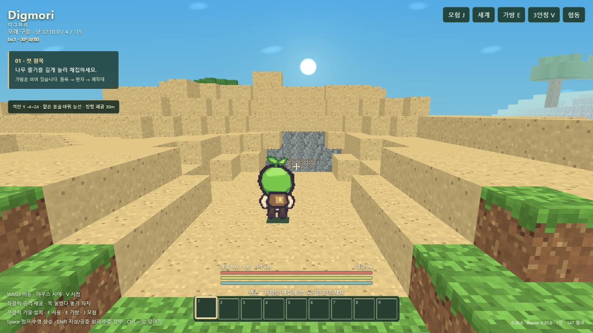
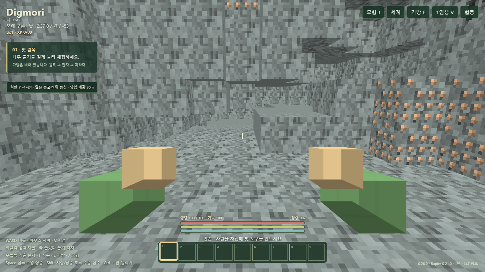
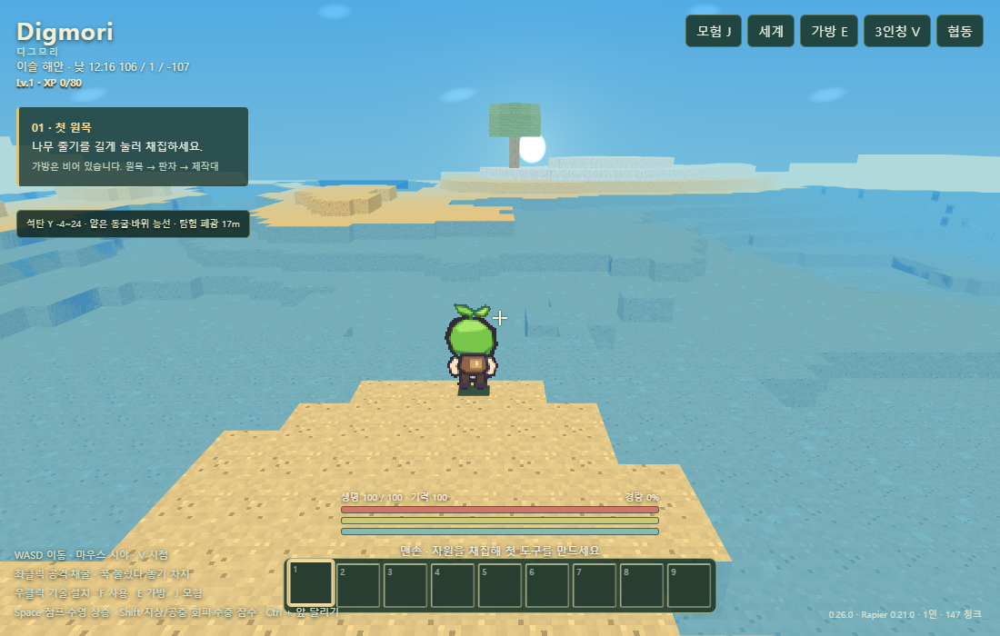
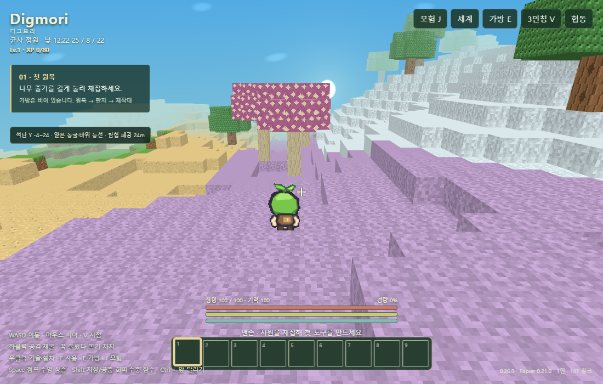

# 0.26.0 지형·탐험 검증

## 원인과 변경

0.25.0의 자연 수원은 32×32 셀 해시로 고른 땅 높이+1에 생겼으며 지형의 오목함이나 유역을 검사하지 않았다. 5개 시드 샘플에서 평지·경사면 수원을 확인했다. 기존 동굴 노이즈는 지표 아래 깊이 4 미만을 무조건 보존하여 지표 구멍이 샘플에서 0개였고, 대부분의 바이옴은 동일한 잔디 지표였다. 절벽 측면의 노출 가능성까지 없었다는 뜻은 아니다.

자연 물은 해수면 아래의 실제 지표가 있는 곳에만 생성한다. 바다와 낮은 분지 물은 유지하며 플레이어가 설치한 물, 흐름 큐·작업 상한·공간 인덱스는 유지한다. 기후 노이즈로 5개 바이옴의 표면·식생·높이·광맥을 구분한다. 자연 동굴은 건조한 지형에 내려가는 통로와 광물 노출 공간을 생성한다. 시작 동굴은 (0, -20)에서 접근 가능하고 주변 지형을 완만하게 연결한다. 폭·천장·내리막 간격은 시드로 달라진다. 기존 지하 노이즈 동굴·갱도·던전도 유지한다.

공통 GameKit 변경 없음: dist SHA `87cac89042256297c025e880aa70ad9cd25ef8ab`. 게임 전용 생성 규칙은 src/data와 src/world에 있다. 실제 Worker 실행에서 발견한 columnKey 직렬화 누락을 고쳤다.

## 확인한 범위

- [5개 시드 구조 기록](terrain-seeds-0.26.0.json): 0, 1, 77, 190725, 995591. 반경 128블록의 4블록 간격 표본에서 모두 5개 기후가 나타났다. 반경 64의 동굴 입구 수는 각각 4/2/1/2/2. 시작 동굴 포함 중심 경로의 바닥·3블록 머리 공간·침수 검사 모두 이상 없음. 로딩한 앞 12개 청크의 새 인스턴스 재생성 바이트가 일치했다. 무한 월드 전체를 보장하는 검사는 아니다.
- [실제 Edge E2E](verification-terrain.json): 부팅→새 월드→WASD 이동→채굴·회수·설치→저장→새로고침→복원. 새 월드에서 W 입력으로 시작 동굴 지하까지 이동, 체력 100, 침수 없음, 석탄·철 노출 확인. 이동을 위해 좌표를 주입하지 않았다. 5개 실제 SDK 응답과 선언된 SHA 일치, Worker 실패 및 페이지 오류 0. 180초 제한 안에 통과.
- [렌더링 장면](terrain-scenes-0.26.0.json): 실제 Edge/WebGL/SDK로 서리·모래·균사·숲·해안 확인. 장면 검사는 관찰자 위치를 주입한 시각 표본이며 위 자연 입력 E2E와 구분한다. Worker 실패 0, WebGL 컨텍스트 손실 없음. 숲 장면은 수관의 카메라 가림이 있어 대표 이미지에서 제외했다.
- 모바일 844×390 터치 에뮬레이션에서 모험창 경계 확인. 실제 모바일 기기, 외부 NAT 멀티플레이, 모든 시드·던전·전투 조합, 장기 성능은 미검증이다.

## 실제 렌더링

## 저장 호환

게임·snapshotVersion 0.26.0. 생성 규칙과 블록 정의가 달라 0.25.0 포함 이전 저장은 지원하지 않으며 새 월드가 필요하다. 저장 키를 바꾸거나 기존 데이터를 삭제하지 않는다. 메뉴와 저장 버전 오류에서 안내하며 자동 변환은 하지 않는다.
